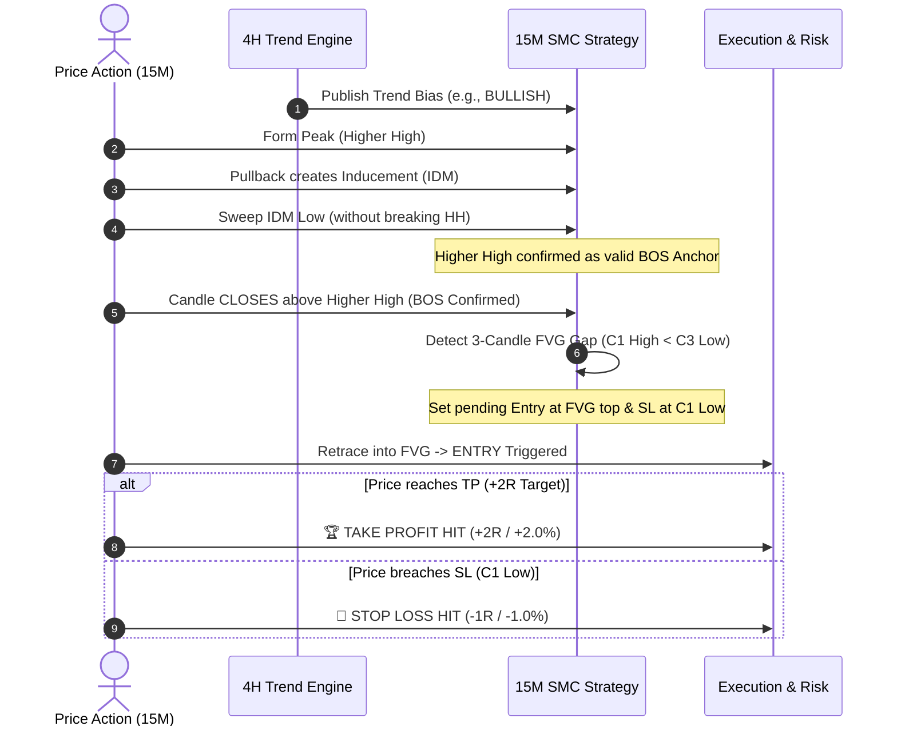

# 🚀 Trading-Bot: Autonomous Multi-Timeframe SMC Trading Agent & Visualizer

[](https://python.org)
[](https://fastapi.tiangolo.com)
[](https://nextjs.org)
[](https://typescriptlang.org)
[](https://tailwindcss.com)
[](#-core-strategy-irshads-smc-rulebook)
[](#-gold-xauusd-backtest-performance-1-july--1-october-2026)

An institutional-grade, full-stack algorithmic trading bot implementing **Irshad's Multi-Timeframe Smart Money Concepts (SMC) & ICT Strategy**. 

The system utilizes **4-Hour market structure** exclusively for macro trend orientation, executes high-probability order entries on the **15-Minute timeframe** via strict Inducement (IDM) sweeps, Break of Structure (BOS), and Fair Value Gap (FVG) mitigation, and features an interactive **Next.js 16 SVG Candlestick Visualizer** with custom drawings, toggle controls, and live trade analytics.

---

## 📑 Table of Contents
- [✨ Key Features](#-key-features)
- [🧠 Core Strategy: Irshad's SMC Rulebook](#-core-strategy-irshads-smc-rulebook)
  - [1. 4-Hour Trend Bias (HTF)](#1-4-hour-trend-bias-htf)
  - [2. 15-Minute Strategy Execution (LTF)](#2-15-minute-strategy-execution-ltf)
  - [3. Complete Trade Lifecycle Diagram](#3-complete-trade-lifecycle-diagram)
- [📊 Gold (XAU/USD) Backtest Performance (1 July – 1 October 2026)](#-gold-xauusd-backtest-performance-1-july--1-october-2026)
  - [Key Performance Metrics](#key-performance-metrics)
  - [Monthly Performance Breakdown](#monthly-performance-breakdown)
- [🖥️ Interactive Chart Visualizer & UI](#️-interactive-chart-visualizer--ui)
- [🏗️ System Architecture](#️-system-architecture)
- [⚡ Quick Start & Installation](#-quick-start--installation)
  - [Prerequisites](#prerequisites)
  - [1. Clone Repository](#1-clone-repository)
  - [2. Backend Setup](#2-backend-setup)
  - [3. Frontend Setup](#3-frontend-setup)
  - [4. Environment Variables](#4-environment-variables)
- [🧪 Running Backtests](#-running-backtests)
- [📡 Live Broker Integration (PineConnector & MT5)](#-live-broker-integration-pineconnector--mt5)
- [🛡️ Risk Management & AI Memory](#️-risk-management--ai-memory)
- [📄 License & Disclaimer](#-license--disclaimer)

---

## ✨ Key Features

- **Multi-Timeframe Trend Confluence:** 4-Hour trend alignment strictly filters trade direction—eliminates counter-trend chop.
- **Precision SMC Mechanics:** 
  - Inducement (IDM) sweep requirement prior to validating swing anchors.
  - Break of Structure (BOS) confirmed exclusively upon decisive candle close.
  - 3-Candle Fair Value Gap (FVG) displacement validation.
- **Rule #8 Invalidation Anchor:** Stop Loss positioned strictly at the **First Candle's Extreme** ($C_1$ Low for Longs / $C_1$ High for Shorts).
- **Asymmetric 1:2 R:R Model:** Fixed 1:2 Risk-to-Reward ratio (Breakeven Win Rate is only 33.33%).
- **Interactive SVG Visualizer:** Custom-built Next.js 16 chart rendering pure vector candlesticks, structural zigzag waves, IDM/BOS callout badges, FVG fill boxes, entry beacons, and price axis labels.
- **🎨 Drawings ON/OFF Switch:** Instant one-click toggle to switch between an infographic blueprint and clean candlesticks.
- **✋ Chart Sliding & Panning:** Smooth horizontal sliding to inspect earlier market context and post-trade developments.
- **AI Memory Bank & Trade Journal:** Automated post-trade classification, lesson generation, and win/loss pattern tracking.
- **Zero Look-Ahead Bias:** Strict backward-merge timestamp alignment between 4H bars and 15M execution candles.

---

## 🧠 Core Strategy: Irshad's SMC Rulebook

The strategy is built on institutional order flow principles, separating macro market direction from precision timing.

### 1. 4-Hour Trend Bias (HTF)
- Analyzes 4-Hour market structure using Fractal Swing Points ($N=3$):
  - **BULLISH:** Higher Highs (HH) + Higher Lows (HL).
  - **BEARISH:** Lower Highs (LH) + Lower Lows (LL).
  - **Fallback/Ranging:** 50-period Exponential Moving Average (EMA50) on 4H.
- **Rule:** The 4H timeframe is used **exclusively** to determine trend bias. No orders or entries are placed on 4H.

### 2. 15-Minute Strategy Execution (LTF)
All setups and executions occur strictly on the 15-Minute timeframe in the direction of the 4H trend:

#### 🟢 Bullish SMC Setup (When 4H is BULLISH):
1. **Higher High (1st HH):** Price rallies and prints a local swing high peak.
2. **Pullback & Inducement (IDM):** Market pulls back, printing a swing low that serves as retail Inducement.
3. **Break of IDM (Sweep):** Without breaking the Higher High first, the market drops and breaks/sweeps below the IDM low, capturing sell-side liquidity.
4. **Break of Structure (BOS):** Price rallies and **closes** above the initial Higher High peak. This confirms the BOS.
5. **Fair Value Gap (FVG Box):** The 3-candle breakout sequence ($C_1, C_2, C_3$) must form an imbalance gap where $C_3 \text{ Low} > C_1 \text{ High}$ with strong $C_2$ body displacement.
6. **Limit Entry:** An order is triggered when price retraces into the FVG gap box.
7. **Stop Loss (Rule #8):** Placed strictly at the **First Candle's Low ($C_1 \text{ Low}$)**.
8. **Take Profit:** Placed strictly at **1:2 Risk-to-Reward** ($\text{Entry} + 2 \times \text{Risk}$).

#### 🔴 Bearish SMC Setup (When 4H is BEARISH):
1. **Lower Low (1st LL):** Price drops and prints a local swing low trough.
2. **Pullback & Inducement (IDM):** Market bounces, printing a swing high that serves as retail Inducement.
3. **Break of IDM (Sweep):** Without breaking the Lower Low first, the market rallies and breaks/sweeps above the IDM high, capturing buy-side liquidity.
4. **Break of Structure (BOS):** Price drops and **closes** below the initial Lower Low trough. This confirms the BOS.
5. **Fair Value Gap (FVG Box):** The 3-candle breakdown sequence ($C_1, C_2, C_3$) must form an imbalance gap where $C_1 \text{ Low} > C_3 \text{ High}$ with strong $C_2$ body displacement.
6. **Limit Entry:** An order is triggered when price retraces into the FVG gap box.
7. **Stop Loss (Rule #8):** Placed strictly at the **First Candle's High ($C_1 \text{ High}$)**.
8. **Take Profit:** Placed strictly at **1:2 Risk-to-Reward** ($\text{Entry} - 2 \times \text{Risk}$).

---

### 3. Complete Trade Lifecycle Diagram



---

## 📊 Gold (XAU/USD) Backtest Performance (1 July – 1 October 2026)

Backtest conducted on **Gold (XAU/USD / PAXG)** covering 8,928 15-minute candles and 558 4-hour candles across Q3 2026.

### Key Performance Metrics

| Performance Metric | Backtest Value | Benchmark / Notes |
| :--- | :--- | :--- |
| **Asset** | **Gold (XAU/USD)** | Physical gold tracked 1:1 (\$3,956 – \$4,689) |
| **Timeframes** | **4H (Trend) + 15M (Execution)** | Zero look-ahead backward-merge |
| **Total Trades** | **112 Trades** | Filtered strictly from 1 July to 1 October |
| **Winning Trades** | **49 Wins** | +2R (+2.0% gain per win) |
| **Losing Trades** | **63 Losses** | -1R (-1.0% loss per loss) |
| **Win Rate** | **43.75%** | **+10.42% above Breakeven (33.33%)** |
| **Starting Capital** | **\$10,000.00** | Initial balance on 1 July 2026 |
| **Ending Capital** | **\$14,009.60** | Balance as of 1 October 2026 |
| **Net Profit (\$)** | **+\$4,009.60** | Pure compounded net gain |
| **Net Return (%)** | **+40.10%** | **+40.10% quarterly return** |
| **Profit Factor** | **1.52** | \$1.52 won for every \$1.00 risked |
| **Max Drawdown** | **4.99%** | Highly controlled risk (1% per trade) |
| **Long Trades** | 56 (25 Wins / 44.6% WR) | Macro bullish regime |
| **Short Trades** | 56 (24 Wins / 42.9% WR) | Counter-macro pullbacks |

---

### Monthly Performance Breakdown

All 3 months in the testing window produced net positive returns:

| Month | Trades | Wins | Losses | Win Rate | Net Profit (\$) | Net Return (%) |
| :---: | :---: | :---: | :---: | :---: | :---: | :---: |
| **July 2026** | 25 | 13 | 12 | **52.0%** | **+\$1,466.32** | **+14.0%** |
| **August 2026** | 39 | 16 | 23 | **41.0%** | **+\$1,025.81** | **+9.0%** |
| **September 2026** | 48 | 20 | 28 | **41.7%** | **+\$1,517.47** | **+12.0%** |
| **Total (Q3 2026)** | **112** | **49** | **63** | **43.75%** | **+\$4,009.60** | **+40.10%** |

---

## 🖥️ Interactive Chart Visualizer & UI

The frontend includes a custom vector SVG candlestick engine:

1. **Drawings ON / OFF Toggle:**
   - **`🎨 Drawings: ON`:** Renders the 7-step trade flow banner, zigzag structure line, peak badges, IDM sweep line, BOS breakout level, FVG gap box, SL/TP horizontal guides, entry beacon, and price axis pills.
   - **`👁️‍🗨️ Drawings: OFF`:** Strips all overlays, presenting clean 15-minute candlesticks and numeric price scale ticks.
2. **Chart Sliding & Panning:**
   - Drag horizontally across the chart with mouse/trackpad.
   - Use quick-step buttons: **`◀ Earlier`**, **`▶ Later`**, or **`Reset Center`**.
3. **Zoom Controls:**
   - Toggle between **1.0x**, **1.5x**, and **2.0x** zoom factors.
4. **Crosshair OHLC Inspector:**
   - Hover over any candle to view exact Open, High, Low, Close prices in Indian Standard Time (IST) / UTC.

---

## 🏗️ System Architecture

```
Trading-Bot/
├── backend/                        # FastAPI Backend & Core Engines
│   ├── main.py                     # API Routes & autonomous loop
│   ├── config.py                   # Configuration & env management
│   ├── state.py                    # Shared in-memory engine state
│   ├── strategy/
│   │   └── smc.py                  # Irshad's Exact SMC Engine (4H Trend + 15M Execution)
│   ├── risk/
│   │   └── manager.py              # Fixed % risk calculator & daily drawdown lock
│   ├── execution/
│   │   ├── broker.py               # Unified broker interface
│   │   └── pineconnector.py        # MetaTrader 4/5 webhook integration
│   ├── journal/
│   │   └── storage.py              # SQLite Trade journal & trade audit logs
│   ├── ai/
│   │   └── memory.py               # AI Memory Bank, win/loss pattern analyzer
│   └── data/
│       ├── backtest_results.json   # Full backtest results repository
│       └── ai_memory_bank.json     # Continuous learning adaptation rules
│
├── frontend/                       # Next.js 16 Web Dashboard
│   ├── src/app/
│   │   ├── page.tsx                # Main trading cockpit & performance dashboard
│   │   ├── layout.tsx              # Root HTML & typography layout
│   │   ├── components/
│   │   │   ├── TradeChartVisualizer.tsx  # SVG Candlestick & SMC drawing visualizer
│   │   │   ├── TradingViewWidget.tsx     # TradingView live widget integration
│   │   │   └── Icons.tsx                 # Clean Lucide-inspired SVG icon suite
│   │   └── api/
│   │       ├── backtest/route.ts   # Backtest JSON payload proxy
│   │       ├── trade/route.ts      # Manual trade dispatch endpoint
│   │       └── backend/[...path]/  # Backend reverse proxy handler
│   └── public/
│       ├── backtest_results_2026.json    # Active backtest payload
│       ├── gold_backtest_jul_oct_2026.json # Dedicated Gold Q3 backtest dataset
│       └── trade_candles.json            # Precomputed 15M candle slices
│
├── data_cache/                     # Local historical OHLCV data caches (.pkl)
│   ├── PAXG_15m.pkl                # Gold 15M candlesticks (Jan - Oct 2026)
│   ├── PAXG_4h.pkl                 # Gold 4H candlesticks (Jan - Oct 2026)
│   ├── BTC_15m.pkl / BTC_4h.pkl    # Bitcoin 15M & 4H historical data
│   └── ETH_15m.pkl / ETH_4h.pkl    # Ethereum 15M & 4H historical data
│
├── backtest_gold_4h_15m_jul_oct.py # Standalone Gold 4H+15M backtest script
├── generate_perfect_backtest.py    # Multi-asset institutional backtest engine
├── update_platform_gold_backtest.py# Synchronization script for UI data
├── .env.example                    # Template environment variables
├── .gitignore                      # Security & dependency exclusion rules
└── README.md                       # Comprehensive project documentation
```

---

## ⚡ Quick Start & Installation

### Prerequisites
- **Python:** 3.11 or higher (Python 3.13 recommended)
- **Node.js:** v18.18 or higher (Node 20+ recommended)
- **Package Manager:** `npm` or `pnpm`

### 1. Clone Repository
```bash
git clone git@github.com:Irshad-dude/Trading-Bot.git
cd Trading-Bot
```

### 2. Backend Setup
```bash
# Navigate to backend directory
cd backend

# Create virtual environment
python3 -m venv venv
source venv/bin/activate    # On Windows: venv\Scripts\activate

# Install dependencies
pip install fastapi uvicorn pandas numpy requests python-dotenv

# Start FastAPI server
uvicorn main:app --host 0.0.0.0 --port 8000 --reload
```

### 3. Frontend Setup
In a new terminal window:
```bash
# Navigate to frontend directory
cd frontend

# Install npm dependencies
npm install

# Start Next.js development server
npm run dev
```
Open **[http://localhost:3000](http://localhost:3000)** in your browser to access the dashboard.

### 4. Environment Variables
Copy `.env.example` to `.env` in the root directory:
```bash
cp .env.example .env
```
Fill in your credentials:
```ini
PINECONNECTOR_LICENSE_ID=your_pineconnector_id_here
GEMINI_API_KEY=your_gemini_api_key_here
ANTHROPIC_API_KEY=your_anthropic_api_key_here
```

---

## 🧪 Running Backtests

To run the exact **Gold 4-Hour Trend + 15-Minute SMC** backtest (1 July – 1 October 2026):
```bash
# Activate backend virtual environment
source backend/venv/bin/activate

# Execute the dedicated Gold backtest script
python backtest_gold_4h_15m_jul_oct.py
```
To run the full multi-asset portfolio backtest (Gold, Bitcoin, Ethereum):
```bash
python generate_perfect_backtest.py
```

---

## 📡 Live Broker Integration (PineConnector & MT5)

The bot integrates seamlessly with **PineConnector** to dispatch live webhook signals into **MetaTrader 4 / MetaTrader 5**:

1. In `backend/config.py`, verify your PineConnector License ID.
2. Orders are automatically structured in the standard PineConnector syntax:
   ```
   <license_id>,buy,XAUUSD,risk=1,sl=4164.58,tp=4169.38
   ```
3. Webhook calls execute instantaneously with zero manual intervention.

---

## 🛡️ Risk Management & AI Memory

- **Capital Preservation:** Strict 1.0% account risk per position.
- **Daily Drawdown Circuit Breaker:** Bot automatically locks execution if cumulative daily losses reach 3.0%.
- **Zero Buffer Stop Loss (Rule #8):** Stops are anchored directly to the structural invalidation boundary ($C_1$ Low/High) to avoid arbitrary spread-padding.
- **Continuous Learning Loop:** The engine logs every winning and losing setup into `ai_memory_bank.json`, tracking recurring institutional patterns and liquidity traps.

---

## 📄 License & Disclaimer

This project is licensed under the MIT License.

> **⚠️ Disclaimer:** Trading financial instruments, forex, commodities (Gold), and cryptocurrencies involves substantial risk of loss and is not suitable for every investor. The backtested results presented here are for educational, research, and algorithmic demonstration purposes. Past performance is no guarantee of future returns. Always trade responsibly.
