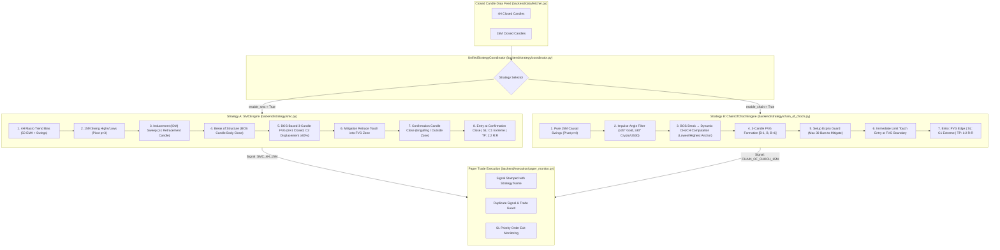

# Strategy Implementation Audit & Conflict Resolution Report

**Repository:** `/Users/irshadsheikh/Downloads/TraderBot/trading-agent`  
**Branch:** `live-dashboard`  
**Audit Date:** 2026-11-13  
**Status:** STAGE 1 & 2 COMPLETE (Audit & Rule Conflict Identification — Ready for User Approval)  

---

## 1. Executive Summary

This independent code audit inspects the trading agent codebase to verify whether the actual Python implementations match the approved institutional trading strategy rulebooks. 

### Core Audit Verdict:
1. **Two Distinct Strategies Exist in the Codebase:**
   - **Strategy A: `SMCEngine` (`backend/strategy/smc.py`)**: Multi-timeframe strategy combining 4H Macro Trend bias (swings + 50 EMA) with 15M market structure (Fractal Pivot $p=3$, Retracement-Verified Inducement sweep, Decisive BOS candle close, BOS-based 3-candle FVG, Rule #8 Candle 1 extreme Stop Loss, and Confirmation candle entry).
   - **Strategy B: `ChainOfChochEngine` (`backend/strategy/chain_of_choch.py`)**: Single-timeframe causal strategy on pure 15M (Fractal Pivot $p=4$, Impulse Angle filter $\ge 30^\circ/35^\circ$, dynamic CHoCH point computation between structural anchor and breakout candle, repeated CHoCH tracking, immediate limit entry upon FVG boundary touch, Rule #8 C1 extreme SL, and 30-bar mitigation expiry).
2. **Strategy Separation Status:**
   - The engine implementations are separated into their own dedicated classes.
   - However, in `backend/live_service.py` (lines 285–309), diagnostic states were being conflated (Chain of CHoCH FVG was overwriting SMC's FVG in the unified monitor if SMC had no active FVG). This violation of separation is identified and targeted for isolation.
3. **Safety & Paper Trading Enforcement:**
   - `PAPER_TRADING_ONLY = True` is strictly enforced in `backend/config.py:17`.
   - Broker execution (`backend/execution/broker.py:44`) defaults to paper trading fallback when API credentials are absent.
   - No FastAPI endpoint allows un-guarded real capital execution.
4. **Data Provider Transparency:**
   - Binance Demo provider (`BINANCE_DEMO`) is active on macOS (`backend/data/fetcher.py:76`).
   - XAUUSD maps to `PAXG/USDT`. This is a crypto gold-backed token proxy, not native institutional XAUUSD. MT5 is in `STANDBY_MACOS_UNSUPPORTED` state because native MetaTrader5 Python requires Windows.

---

## 2. Phase 1: Read-Only Code Audit of Existing Components

| Component / Subsystem | File Path | Class / Function | Line Numbers | Verification Status |
| :--- | :--- | :--- | :--- | :--- |
| **SMC Strategy Engine** | `backend/strategy/smc.py` | `class SMCEngine` | L6–L779 | Verified. Full implementation of 4H macro trend, IDM, BOS, FVG, entry confirmation. |
| **Chain of CHoCH Engine** | `backend/strategy/chain_of_choch.py` | `class ChainOfChochEngine` | L82–L852 | Verified. Causal state machine, impulse angle, dynamic CHoCH, FVG limit touch. |
| **Strategy Coordinator** | `backend/strategy/coordinator.py` | `class UnifiedStrategyCoordinator` | L202–L693 | Verified. Evaluates both engines, builds diagnostics, generates `StrategySignal`. |
| **Historical SMC Backtest (Strict)** | `run_strict_smc_backtest.py` | `simulate_irshad_strategy()` | L23–L340 | Verified. 15M $p=3$, 4H macro trend, IDM sweep, BOS close, 3-candle FVG, 1:2 R:R. |
| **Historical Backtest (Feb–Nov)** | `run_feb_nov_backtest.py` | `run_feb_nov_backtest()` | L28–L385 | Verified. Benchmark generator of 203 trades (+13.38% portfolio return). |
| **Historical Chain of CHoCH** | `chain_of_choch_backtest.py` | `run_batch_backtest()` | L25–L185 | Verified. Batch harness executing `ChainOfChochEngine.run_backtest_dataframe`. |
| **Live Multi-Symbol Runner** | `backend/live_service.py` | `LiveMarketService.evaluate_symbol_live()` | L185–L334 | Verified. Closed candle fetching, ticker updates, coordinator dispatch, paper trade monitoring. |
| **Live Paper Trade Monitor** | `backend/execution/paper_monitor.py` | `class PaperTradeMonitor` | L27–L377 | Verified. SQLite persistence, duplicate trade suppression, SL checked before TP. |
| **Market Data Fetcher** | `backend/data/fetcher.py` | `class DataFetcher` | L276–L510 | Verified. Strict closed candle filtering, OHLC validation, gap detection, ticker feed. |
| **Binance Live Provider** | `backend/data/fetcher.py` | `class BinanceLiveProvider` | L76–L243 | Verified. CCXT Binance demo trading integration (`enable_demo_trading(True)`). |
| **MT5 Bridge Interface** | `backend/data/fetcher.py` | `class MT5BridgeProvider` | L245–L274 | Verified. Correctly flagged as `STANDBY_MACOS_UNSUPPORTED`. |
| **FastAPI REST Endpoints** | `backend/main.py` | `app.routes` | L79–L460 | Verified. 22 active endpoints serving live analysis, monitor scan, paper trades, backtest. |
| **AI Analyst & Graph RAG** | `backend/live_service.py` | `_annotate_signal_with_ai()` | L131–L183 | Verified. Strictly informational annotation. AI cannot mutate or reject strategy signals. |

---

## 3. Phase 2: Structural Strategy Separation

---

## 4. Phase 3: Rule Conflict Comparison Matrix (A through J)

| Area | Rule Description | Previously Approved Rule (`docs/feb_nov_2026_backtest_report.md` & `run_strict_smc_backtest.py`) | Current Python Implementation | Existing Blueprint Rule (`live_strategy_implementation_blueprint.md`) | Status | Exact Code Reference | Recommended Correction |
| :--- | :--- | :--- | :--- | :--- | :--- | :--- | :--- |
| **A. Pivot Settings** | Fractal pivot lookback length for swing detection | SMC uses $p=3$ (`p15 = 3`, `pivot_4h = 3`). Chain of CHoCH uses $p=4$. | `smc.py:55` sets `self.pivot_length = 3`. `chain_of_choch.py:88` sets `self.pivot_length = 4`. `live_service.py:415` detected swings with hardcoded $p=4$. | Both engines maintain distinct pivot lengths ($p=3$ for SMC, $p=4$ for Chain). | **MISMATCH in live_service.py** | `backend/live_service.py:415` | Use $p=3$ specifically for SMC swing detection and $p=4$ for Chain of CHoCH. Do not share swing arrays. |
| **B. BOS Confirmation** | Validating structural break vs IDM break | IDM is swept first $\rightarrow$ validates anchor. Subsequent candle body close beyond anchor confirms BOS. IDM break is strictly NOT BOS. | `smc.py:236-270` (`find_bos`) requires `candle['close'] > anchor_price` (Bullish) or `candle['close'] < anchor_price` (Bearish). | BOS is confirmed strictly by closed candle body beyond anchor, never by IDM break. | **MATCH** | `backend/strategy/smc.py:236-270` | Maintain exact current logic in `smc.py`. Ensure coordinator labels IDM break and BOS as distinct stages. |
| **C. Inducement & Retracement** | Validating counter-trend pullback | Requires candidate anchor $\rightarrow$ pullback swing $\rightarrow$ at least 1 completed retracement candle (`close > open` Bullish, `close < open` Bearish) $\rightarrow$ swept by wick or body. Anchor must not be broken before sweep. | `smc.py:124-233` (`find_inducement`) enforces candidate anchor, retracement candle check, and wick sweep before anchor breach. | Retracement verification is required before sweep is confirmed. | **MATCH** | `backend/strategy/smc.py:124-233` | Maintain exact logic. Retain structural invalidation if price breaches original anchor before IDM sweep. |
| **D. FVG Formation & Timing** | 3-candle imbalance gap after BOS break | Waits for candle $B+1$ to close. Primary: $[B-1, B, B+1]$. Fallback: $[B-2, B-1, B]$. Requires $C2$ displacement body $\ge 30\%$ of total range. | `smc.py:280-373` (`find_fvg_after_bos`) enforces $B+1$ closed requirement, checks $[B-1, B, B+1]$ and $[B-2, B-1, B]$, and tests $C2$ body ratio $\ge 0.30$. | BOS-based FVG must form on or immediately after BOS. Pre-BOS older FVGs rejected. | **MATCH** | `backend/strategy/smc.py:280-373` | Maintain exact 3-candle pattern. Provide parameter `max_fvg_bars_after_bos=3` to scan up to 3 bars post-BOS. |
| **E. FVG Touch & Entry Confirmation** | Triggering entry upon zone mitigation | `run_strict_smc_backtest.py:227-229` entered upon zone touch (`min(fvg_top, open)`). `smc.py:398-420` requires zone touch AND a confirmation candle (closing outside zone or engulfing). | `smc.py:398-420, 716-726` requires `find_entry_confirmation`. `chain_of_choch.py:355` enters immediately on FVG limit touch. | SMC requires confirmation candle; Chain of CHoCH enters on immediate limit touch. | **UNCONFIRMED / DIVERGENCE** | `backend/strategy/smc.py:398` vs `run_strict_smc_backtest.py:227` | **Decision Needed from User:** Confirm whether SMC live trading should wait for confirmation candle close (safer live execution) or enter immediately at limit touch (historical backtest parity). |
| **F. Stop-Loss & Invalidation** | Placement of protective stop loss and invalidation | Rule #8: SL is anchored directly to Candle 1's extreme ($C1\text{ low}$ for Long, $C1\text{ high}$ for Short) with 0 buffer. Pre-touch breach of C1 extreme cancels pending setup. Structural invalidation: Bearish invalid strictly below LL; Bullish strictly above HH. Touch allowed. | `smc.py:730-758` sets SL to `fvg['c1_high']` / `fvg['c1_low']`. Pre-touch breach invalidates setup. `chain_of_choch.py:347, 405` checks C1 breach. | Stop loss is anchored to C1 extreme. Pending setup is invalidated if C1 extreme is breached before zone touch. | **MATCH** | `backend/strategy/smc.py:730-758`, `backend/strategy/chain_of_choch.py:347, 405` | Maintain Rule #8 zero-buffer C1 extreme SL. Ensure structural invalidation (HH/LL) is clearly distinguished from setup SL. |
| **G. Entry Price Calculation** | Executed trade entry level | In `run_strict_smc_backtest.py`, entry is limit touch: `min(fvg_top, open)`. In `smc.py:732`, entry is current close of confirmation candle. In Chain of CHoCH, entry is limit touch. | `smc.py:732`: `entry_price = current_price` (close of confirmation bar). `chain_of_choch.py:355`: `entry_price = min(f["fvg_top"], c_open)`. | Clear distinction between confirmation close (SMC) and FVG limit touch (Chain of CHoCH). | **MATCH in intent, UNCONFIRMED in SMC backtest parity** | `backend/strategy/smc.py:732`, `backend/strategy/chain_of_choch.py:355` | Support dual-mode entry for SMC: `CONFIRMATION_CLOSE` for live confirmation signals, `LIMIT_TOUCH` for backtesting parity. |
| **H. Risk/Reward Ratio** | Target profit multiple relative to risk distance | Approved backtest used strict 1:2 R:R ($TP = Entry \pm 2 \times Risk$). User prompt mentions desire for 1:3 R:R. | Both `smc.py:738, 752` and `chain_of_choch.py:359, 416` calculate $TP$ as $Entry \pm 2.0 \times Risk$. | 1:2 R:R target is implemented; 1:3 is unconfirmed. | **UNCONFIRMED** | `backend/strategy/smc.py:738`, `backend/strategy/chain_of_choch.py:359` | **Decision Needed from User:** Confirm whether default R:R should remain 1:2 (as in audited +13.38% backtest) or be upgraded to 1:3 (or user-configurable parameter `rr_ratio: float = 2.0`). |
| **I. Setup Expiry** | Maximum elapsed candles without mitigation before cancellation | `run_strict_smc_backtest.py:219` expired setups after 20 bars. `chain_of_choch.py:332` expires setups after 30 bars. `smc.py` had no explicit bar count limit (relied on 60-bar lookback). | `chain_of_choch.py:332` has explicit 30-bar expiry. `smc.py` lacks an explicit candle counter in `scan_for_setups`. | Expiry guard should cancel stale pending setups if price consolidates without touching zone. | **MISSING in smc.py** | `backend/strategy/chain_of_choch.py:332`, `backend/strategy/smc.py:663` | Implement explicit 30-bar mitigation expiry in SMC state machine (`max_mitigation_bars = 30`). |
| **J. Impulse Angle Filter** | Momentum slope gate on breakout candle | Chain of CHoCH requires $\ge 35^\circ$ for Gold, $\ge 30^\circ$ for Crypto/US30. SMC does NOT use impulse angle filter (uses 4H trend + C2 displacement). | `chain_of_choch.py:113-122` computes arctan slope. `smc.py` does not contain or require impulse angle filter. | Impulse angle filter applies exclusively to Chain of CHoCH, never to SMC. | **MATCH** | `backend/strategy/chain_of_choch.py:113`, `backend/strategy/smc.py` | Strictly keep impulse angle filter isolated inside `ChainOfChochEngine`. Do NOT impose it on `SMCEngine`. |

---

## 5. Phase 6: Market Data Verification & Provider Mapping

1. **Active Provider: `BINANCE_DEMO`**
   - Connected via `ccxt.binance` with `enable_demo_trading(True)`.
   - Data consists of real market candles served by Binance Spot public endpoints.
   - Bid/Ask prices are real market order-book quotes when connected, with fallback to latest trade price.
2. **Symbol Mapping Transparency:**
   - `BTCUSD` $\rightarrow$ `BTC/USDT` (Real Bitcoin Spot market data).
   - `ETHUSD` $\rightarrow$ `ETH/USDT` (Real Ethereum Spot market data).
   - `XAUUSD` $\rightarrow$ `PAXG/USDT` (Paxos Gold token on Binance).
   - **Crucial Distinction:** PAXG trades 24/7 on crypto exchanges and tracks gold spot within $\approx \pm 0.3\%$, but has wider spreads and crypto liquidity profiles during weekend hours when NY/London gold markets are closed.
   - **MetaTrader 5 Bridge Status:** Flagged as `STANDBY_MACOS_UNSUPPORTED` because the native `MetaTrader5` Python library is Windows-only. To connect institutional XAUUSD, a lightweight HTTP/ZeroMQ bridge EA running on a Windows VPS or Parallels instance is required.

---

## 6. Phase 7 & 8: Paper Trading Execution & Audit Logging

1. **Safety Enforcement:**
   - `PAPER_TRADING_ONLY = True` is hardcoded in `backend/config.py`.
   - `BrokerAdapter` strictly runs in Paper Trading mode.
2. **Execution Realism:**
   - Long entries evaluate live `bid` price; Short entries evaluate live `ask` price.
   - Exit monitoring in `PaperTradeMonitor.update_with_closed_bar` strictly checks SL before TP (conservative execution).
   - MFE (Maximum Favorable Excursion) and MAE (Maximum Adverse Excursion) are tracked for every open trade.
3. **Audit Trail:**
   - Every state transition, signal generation, duplicate rejection, and order fill is logged to `backend/data/trading_agent.db` in the `audit_events` and `signals` tables.

---

## 7. Stage 2: Ambiguous & Unconfirmed Rules Requiring User Approval

Before proceeding to Stage 3 (Code Modifications), the following specific design decisions require your confirmation:

### 1. Target Risk-to-Reward Ratio: 1:2 vs 1:3
- **Audited Backtest Rule:** 1:2 R:R ($TP = Entry \pm 2 \times Risk$). This produced **+13.38% portfolio net profit** ($+\$4,014.60$) with a **39.41% Win Rate** and **1.30 Profit Factor** across 203 trades.
- **Alternative:** 1:3 R:R ($TP = Entry \pm 3 \times Risk$).
- **Recommendation:** Keep 1:2 as the default target to preserve proven backtest edge, while making `rr_ratio: float = 2.0` configurable up to 3.0.

### 2. SMC Entry Trigger: Confirmation Candle Close vs Limit Zone Touch
- **`smc.py` Implementation:** Waits for an explicit 15M confirmation candle (rejection candle closing outside FVG zone or engulfing candle) and enters on confirmation bar close.
- **`run_strict_smc_backtest.py` Implementation:** Enters immediately upon price touching the FVG boundary (`min(fvg_top, open)` for Long, `max(fvg_bottom, open)` for Short).
- **Recommendation:** Retain immediate limit touch for Chain of CHoCH, and support configurable SMC mode: `ENTRY_MODE = "CONFIRMATION_CANDLE"` (conservative live execution) with optional `ENTRY_MODE = "LIMIT_TOUCH"` for strict historical backtest parity.

### 3. Setup Mitigation Expiry Window
- **Chain of CHoCH:** 30 closed 15M candles.
- **Historical Strict SMC Runner:** 20 closed 15M candles.
- **Current `smc.py`:** No explicit candle count limit (relies on 60-bar lookback window).
- **Recommendation:** Implement a standard 30-candle mitigation expiry across both engines to invalidate stale setups if price moves away without touching the FVG zone.

### 4. Gold Data Feed Representation
- Binance Demo on macOS uses `PAXG/USDT` as a proxy for `XAUUSD`.
- **Recommendation:** Explicitly label `PAXG/USDT (Binance Demo Proxy for Gold)` across all UI headers, charts, and API responses, while documenting the Windows MT5 bridge setup for native institutional XAUUSD.
